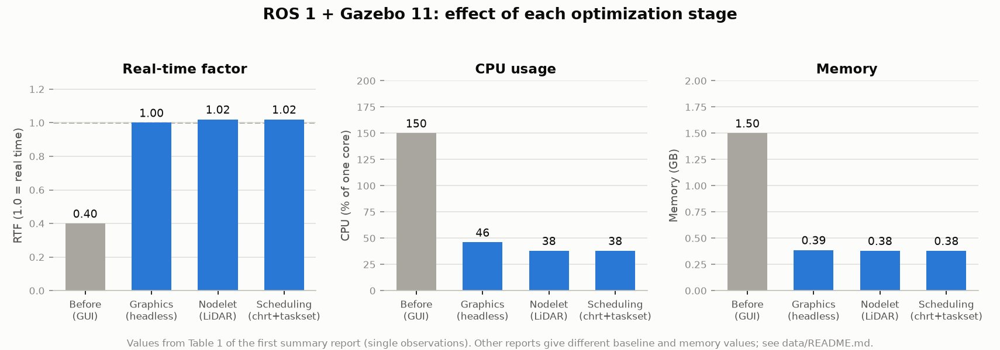
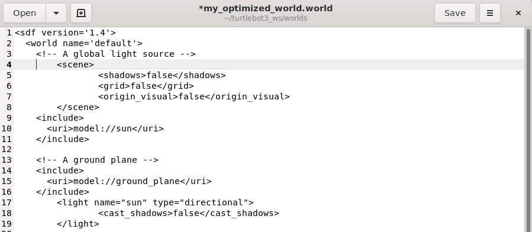
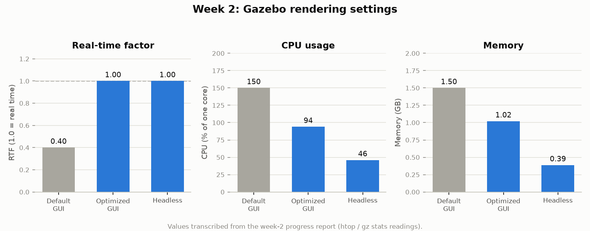
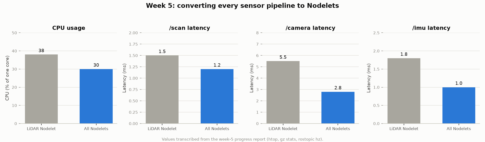
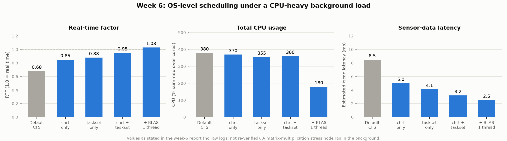

# ROS / Gazebo Simulation Performance Optimization

**A layer-by-layer study of what slows a TurtleBot3 Gazebo simulation down, and of how rendering settings, Nodelets and OS scheduling bring it back to real time.**


[English](#english) · [中文](#中文)

---

## English

### Overview

On limited hardware (Windows 10 + WSL2, 4 logical CPUs) the TurtleBot3 Gazebo simulation with the GUI was CPU-heavy, and the summary reports record it running at only 0.40× real time (see the note under *Highlights*). This undergraduate capstone project at Yuan Ze University measured where the CPU time went and removed the bottlenecks in four layers:

1. **Graphics**: no shadows or extra light sources, headless `gzserver` (`gui:=false`)
2. **Sensors**: lower LiDAR and camera rate and resolution
3. **ROS communication**: LiDAR, camera and IMU pipelines rewritten as **Nodelets** (zero-copy, single process)
4. **Operating system**: real-time priority (`chrt`), CPU affinity (`taskset`) and a single-threaded OpenBLAS

The steps were evaluated with the **real-time factor (RTF)**, CPU usage, memory and topic latency, using ROS Noetic and Gazebo 11.

### Highlights

| | Before | After | Source |
|---|---|---|---|
| ROS 1 stage summary: RTF | 0.40 | **1.02** | first summary report, Table 1 ¹ |
| ROS 1 stage summary: CPU | ≈150 % | **≈38 %** | first summary report, Table 1 ¹ |
| Week 2, optimized world, GUI → headless: CPU (RTF 1.00 in both) | ≈94 % | **≈46 %** | week-2 report |
| Week 4, LiDAR subscriber → Nodelet: `/scan` latency | 3.2 ms | **1.5 ms** | week-4 report |

¹ The reports disagree on the starting point and on memory. The week-1 report's own reading of the default GUI setup was RTF 1.00 at ≈110 % CPU and ≈1.07 GB, while the week-2 cross-week table and the summary reports use RTF 0.40 / ≈150 % / 1.5 GB for the same setup. Memory after the Nodelet stage is ≈380 MB in the summary table but 1.2–1.3 GB in the week-5 report and the six-week summary. Every value is shown as its report states it; see [`data/README.md`](data/README.md) and [`docs/write-up.md`](docs/write-up.md).

### Experiment design

| Phase | Factor tested | Configurations compared | Metrics |
|---|---|---|---|
| ROS 1, week 1 | Baseline profiling | TurtleBot3 Waffle Pi in `turtlebot3_world`, GUI on | RTF, per-process CPU, memory |
| ROS 1, week 2 | Rendering | default GUI · optimized world with GUI · optimized world headless | RTF, CPU, memory |
| ROS 1, week 3 | Sensor parameters | LiDAR / camera rate and resolution lowered (summary only) | CPU |
| ROS 1, week 4 | Nodelet | standalone LiDAR subscriber · same logic as a Nodelet | RTF, CPU, `/scan` latency |
| ROS 1, week 5 | Nodelet (all sensors) | LiDAR-only Nodelet · LiDAR + camera + IMU Nodelets | RTF, CPU, memory, topic latency |
| ROS 1, week 6 | OS scheduling, with an OpenBLAS matrix-multiplication stress node | CFS default · `chrt` · `taskset` · both · both + `OPENBLAS_NUM_THREADS=1` | RTF, total CPU, latency, memory |

Tools: `gz stats` (RTF), `htop`/`top` (CPU, memory; 100 % = one core), `rostopic hz` (rate, latency estimate).

### Results

#### 1. ROS 1: stage-by-stage progression

| Stage | RTF | CPU | Memory | Main measures |
|---|---|---|---|---|
| Before optimization | 0.40 | ≈150 % | 1.50 GB | none |
| Graphics | 1.00 | ≈46 % | 387 MB | shadows / extra lights off, headless |
| Nodelet | 1.02 | ≈38 % | ≈380 MB | LiDAR subscriber as a Nodelet |
| Scheduling | 1.02 | ≈38 % | ≈380 MB | CPU affinity, real-time priority |

Values from Table 1 of the first summary report (May 2025). The same report series also contains different numbers for the first and last rows: the week-1 report measured RTF 1.00 / ≈110 % / ≈1.07 GB for the default GUI setup, and the week-5 report and six-week summary give 1.2–1.3 GB of memory after Nodelets. See the note under *Highlights*.



#### 2. Week 2: rendering settings and headless mode

Disabling shadows, the grid and the origin marker in a copy of the world file, then dropping `gzclient` altogether. RTF stays at 1.00 while CPU falls from ≈94 % to ≈46 % and memory from 1.02 GB to 387 MB.



*Screenshot from the week-2 report, taken while editing (the file is still unsaved) and cropped to the edited top of the file. According to the report, the stock `<scene>` block further down the file, which turns shadows back on, was removed afterwards. See [`configs/optimized_world_snippet.sdf`](configs/optimized_world_snippet.sdf).*



#### 3. Weeks 4–5: Nodelets

| Comparison | RTF | CPU | `/scan` | `/camera` | `/imu` |
|---|---|---|---|---|---|
| Week 4: standalone node → Nodelet | 1.00 → 1.02 | 42 % → 38 % | 3.2 → 1.5 ms | – | – |
| Week 5: LiDAR-only → all sensors as Nodelets | 1.02 → 1.00 | 38 % → 30 % | 1.5 → 1.2 ms | 5.5 → 2.8 ms | 1.8 → 1.0 ms |



#### 4. Week 6: OS scheduling under a CPU-heavy background load

| Strategy | RTF | Total CPU | Est. `/scan` latency | Memory |
|---|---|---|---|---|
| Default (CFS) | 0.68 | 380 % | 8.5 ms | 500 MB |
| `chrt -f 99` only | 0.85 | 370 % | 5.0 ms | 500 MB |
| `taskset` only | 0.88 | 355 % | 4.1 ms | 498 MB |
| `chrt` + `taskset` | 0.95 | 360 % | 3.2 ms | 498 MB |
| + `OPENBLAS_NUM_THREADS=1` | **1.03** | **180 %** | **2.5 ms** | 480 MB |



By RTF, real-time priority and CPU affinity did most of the work (0.68 → 0.85 with `chrt`, → 0.88 with `taskset`, 0.95 together). Limiting OpenBLAS to one thread gave the largest CPU reduction (≈360 % → 180 %) and was the step that pushed RTF above 1.0 (0.95 → 1.03): on a saturated machine the extra BLAS threads only competed with `gzserver`.

The week-6 report gives these values without raw logs or measurement screenshots. They are reproduced as stated and have not been re-verified.

#### Where each figure comes from

| Figure | Data | Per-trial raw data |
|---|---|---|
| `ros1_*.png` | tables transcribed from the weekly progress reports into `data/ros1_*.csv`, drawn by `scripts/plot_ros1_tables.py` | **No**: single readings, so no error bars. Week-6 values not re-verified |
| `week2_optimized_world_file.png` | screenshot from the week-2 report, cropped to the edited part of the file | n/a |

Conditions changed between weeks (robot model, sensors, background load), so compare values within one table rather than across tables. Details are in [`data/README.md`](data/README.md) and the full write-up in [`docs/write-up.md`](docs/write-up.md).

### Project structure

```
ros-gazebo-performance-optimization/
├── README.md
├── LICENSE
├── requirements.txt
├── configs/
│   ├── commands.sh                  # launch / measurement / scheduling commands from the reports
│   └── optimized_world_snippet.sdf  # week-2 rendering edits to the Gazebo world
├── data/
│   ├── README.md                    # provenance, column notes, caveats
│   ├── ros1_stage_summary.csv
│   ├── ros1_graphics_week2.csv
│   ├── ros1_nodelet_results.csv
│   └── ros1_scheduling_results.csv
├── docs/
│   ├── write-up.md                  # method and findings (English)
│   └── write-up.zh-TW.md            # 研究方法與結果（中文）
├── figures/                         # generated charts + one screenshot
└── scripts/
    ├── plot_ros1_tables.py          # redraws the ROS 1 tables as charts
    └── charts.py                    # bar-chart helpers (matplotlib / SVG fallback)
```

### Getting started

```bash
git clone https://github.com/ShengWei0528/ros-gazebo-performance-optimization.git
cd ros-gazebo-performance-optimization
pip install -r requirements.txt          # matplotlib; optional, see below

python scripts/plot_ros1_tables.py       # figures/ros1_*.png
```

Expected output:

```
wrote figures/ros1_stage_progression.png
wrote figures/ros1_week2_gui_vs_headless.png
wrote figures/ros1_week5_nodelet_latency.png
wrote figures/ros1_week6_scheduling.png
```

The script needs only the Python standard library to read the tables. Charts are drawn with matplotlib (Agg backend). Without matplotlib it falls back to a built-in SVG writer (`--format svg`); `--out <dir>` writes the charts somewhere other than `figures/`.

To repeat the simulation-side experiments you need Ubuntu 20.04 with ROS Noetic, Gazebo 11 and the TurtleBot3 simulation packages; see [`configs/commands.sh`](configs/commands.sh).

### Tech stack

ROS 1 Noetic (rospy, Nodelet, roslaunch) · Gazebo 11 · TurtleBot3 · Ubuntu 20.04 on WSL2 · Linux scheduling tools (`chrt`, `taskset`, `htop`) · OpenBLAS · Python 3 (csv, matplotlib)

### Context

- **Course:** Undergraduate Capstone Project (畢業專題), Department of Electrical Engineering, Yuan Ze University (元智大學電機工程學系)
- **Timeline:** weekly ROS 1 progress reports and summary reports, April–June 2025
- **Author:** Sheng-Wei Lu (呂聖韡)

### Credits

- TurtleBot3 robot models and worlds: [ROBOTIS turtlebot3_simulations](https://github.com/ROBOTIS-GIT/turtlebot3_simulations) (Apache-2.0). Simulator: [Gazebo](https://gazebosim.org/). Middleware: [ROS](https://www.ros.org/).
- The week-6 OpenBLAS threading idea follows the ROS Discourse thread [*Massive gazebo performance improvement, YMMV*](https://discourse.ros.org/t/massive-gazebo-performance-improvement-ymmv/39181), which the week-6 report cites.

### License

Code is released under the [MIT License](LICENSE). The write-ups in `docs/`, the data tables and the figures are released under [CC BY 4.0](https://creativecommons.org/licenses/by/4.0/). The exception is `figures/week2_optimized_world_file.png`: it shows an edited copy of the ROBOTIS turtlebot3_simulations world file (Apache-2.0) and is not covered by CC BY 4.0.

---

## 中文

### 專案簡介

在有限的硬體環境（Windows 10 + WSL2，4 個邏輯處理器）下，開啟 GUI 的 TurtleBot3 Gazebo 模擬相當吃 CPU，總結報告記錄的即時因子只有 0.40（見下方「重點成果」的註解）。本專案為元智大學電機系的畢業專題，先量測 CPU 時間花在哪裡，再分四層排除瓶頸：

1. **圖形渲染**：關閉陰影與多餘光源，改用無 GUI 的 `gzserver`（`gui:=false`）
2. **感測器**：下修 LiDAR 與攝影機的頻率與解析度
3. **ROS 通訊**：LiDAR、攝影機、IMU 處理節點改寫為 **Nodelet**（同進程、零拷貝）
4. **作業系統**：即時優先權（`chrt`）、CPU 親和性（`taskset`）、OpenBLAS 單執行緒

各步驟以 **即時因子（RTF）**、CPU、記憶體與 topic 延遲評估成效，環境為 ROS Noetic 與 Gazebo 11。

### 重點成果

| | 優化前 | 優化後 | 資料來源 |
|---|---|---|---|
| ROS 1 階段總結：RTF | 0.40 | **1.02** | 第一次總結報告表一 ¹ |
| ROS 1 階段總結：CPU | ≈150 % | **≈38 %** | 第一次總結報告表一 ¹ |
| 第 2 週，優化場景 GUI → 無 GUI：CPU（兩者 RTF 皆為 1.00） | ≈94 % | **≈46 %** | 第 2 週報告 |
| 第 4 週，LiDAR 訂閱節點 → Nodelet：`/scan` 延遲 | 3.2 ms | **1.5 ms** | 第 4 週報告 |

¹ 各報告對起點與記憶體的數字並不一致。第 1 週報告本身量到的預設 GUI 設定為 RTF 1.00、CPU 約 110 %、記憶體約 1.07 GB；第 2 週報告的跨週比較表與總結報告則對同一設定記為 RTF 0.40、約 150 %、1.5 GB。Nodelet 階段後的記憶體在總結表中約 380 MB，但第 5 週報告與六週總結記為 1.2–1.3 GB。所有數值皆依各報告原文呈現，詳見 [`data/README.md`](data/README.md) 與 [`docs/write-up.zh-TW.md`](docs/write-up.zh-TW.md)。

### 實驗設計

| 階段 | 測試因子 | 比較的設定 | 指標 |
|---|---|---|---|
| ROS 1 第 1 週 | 基準量測 | Waffle Pi + `turtlebot3_world`，開啟 GUI | RTF、各程序 CPU、記憶體 |
| ROS 1 第 2 週 | 圖形渲染 | 預設 GUI · 優化場景＋GUI · 優化場景＋無 GUI | RTF、CPU、記憶體 |
| ROS 1 第 3 週 | 感測器參數 | 下修 LiDAR / 攝影機頻率與解析度（僅見於總結） | CPU |
| ROS 1 第 4 週 | Nodelet | 一般 LiDAR 訂閱節點 · 同功能 Nodelet | RTF、CPU、`/scan` 延遲 |
| ROS 1 第 5 週 | Nodelet（全感測器） | 僅 LiDAR Nodelet · LiDAR＋攝影機＋IMU 皆 Nodelet | RTF、CPU、記憶體、各 topic 延遲 |
| ROS 1 第 6 週 | 作業系統排程（另跑 OpenBLAS 矩陣運算高負載節點） | CFS 預設 · `chrt` · `taskset` · 兩者並用 · 並用＋`OPENBLAS_NUM_THREADS=1` | RTF、總 CPU、延遲、記憶體 |

量測工具：`gz stats`（RTF）、`htop`/`top`（CPU、記憶體；100 % = 一顆核心）、`rostopic hz`（頻率與延遲估計）。

### 結果

#### 1. ROS 1：各階段進展

| 階段 | RTF | CPU | 記憶體 | 主要措施 |
|---|---|---|---|---|
| 優化前 | 0.40 | ≈150 % | 1.50 GB | 無 |
| 圖形渲染優化 | 1.00 | ≈46 % | 387 MB | 關閉陰影 / 多餘光源、無 GUI |
| Nodelet 架構 | 1.02 | ≈38 % | ≈380 MB | LiDAR 訂閱節點 Nodelet 化 |
| 系統資源調度 | 1.02 | ≈38 % | ≈380 MB | CPU 親和性、即時排程 |

數值取自第一次總結報告（2025 年 5 月）的表一。同一系列報告中，第一列與最後幾列另有不同的數字：第 1 週報告量到預設 GUI 為 RTF 1.00、約 110 %、約 1.07 GB；第 5 週報告與六週總結則記錄 Nodelet 化後記憶體為 1.2–1.3 GB。詳見「重點成果」的註解。


#### 2. 第 2 週：圖形設定與無 GUI 模式

在 world 檔副本中關閉陰影、格線與原點標示，再完全不啟動 `gzclient`。RTF 維持 1.00，CPU 由 ≈94 % 降到 ≈46 %，記憶體由 1.02 GB 降到 387 MB。


*第 2 週報告中的截圖，拍攝時檔案仍在編輯中（尚未存檔），此處只裁切出修改過的檔案開頭。依報告所述，檔案後段原有的 `<scene>` 區塊（會把陰影重新打開）之後已刪除，見 [`configs/optimized_world_snippet.sdf`](configs/optimized_world_snippet.sdf)。*


#### 3. 第 4–5 週：Nodelet

| 比較 | RTF | CPU | `/scan` | `/camera` | `/imu` |
|---|---|---|---|---|---|
| 第 4 週：一般節點 → Nodelet | 1.00 → 1.02 | 42 % → 38 % | 3.2 → 1.5 ms | – | – |
| 第 5 週：僅 LiDAR → 全部感測器 Nodelet | 1.02 → 1.00 | 38 % → 30 % | 1.5 → 1.2 ms | 5.5 → 2.8 ms | 1.8 → 1.0 ms |


#### 4. 第 6 週：背景高負載下的作業系統排程

| 策略 | RTF | 總 CPU | 估計 `/scan` 延遲 | 記憶體 |
|---|---|---|---|---|
| 預設（CFS） | 0.68 | 380 % | 8.5 ms | 500 MB |
| 僅 `chrt -f 99` | 0.85 | 370 % | 5.0 ms | 500 MB |
| 僅 `taskset` | 0.88 | 355 % | 4.1 ms | 498 MB |
| `chrt` ＋ `taskset` | 0.95 | 360 % | 3.2 ms | 498 MB |
| ＋`OPENBLAS_NUM_THREADS=1` | **1.03** | **180 %** | **2.5 ms** | 480 MB |


以 RTF 來看，主要的提升來自即時優先權與 CPU 親和性（`chrt` 0.68 → 0.85、`taskset` → 0.88，兩者並用 0.95）。限制 OpenBLAS 為單執行緒帶來最大的 CPU 降幅（≈360 % → 180 %），也是讓 RTF 超過 1.0 的那一步（0.95 → 1.03）：在 CPU 已飽和時，多出來的 BLAS 執行緒只會和 `gzserver` 搶資源。

第 6 週報告提供這些數值時沒有附上原始紀錄或量測截圖，此處依報告原文呈現，未再驗證。

#### 圖表資料來源

| 圖表 | 資料 | 是否有逐次原始資料 |
|---|---|---|
| `ros1_*.png` | 由每週進度報告的表格轉錄成 `data/ros1_*.csv`，由 `scripts/plot_ros1_tables.py` 繪製 | **無**：單次讀值，因此沒有誤差線；第 6 週數值未再驗證 |
| `week2_optimized_world_file.png` | 第 2 週報告中的截圖，只裁切出修改過的部分 | 不適用 |

各週的條件（機器人型號、感測器、背景負載）不同，請在同一張表內比較，不要跨表比較。詳細說明見 [`data/README.md`](data/README.md)，完整中文說明見 [`docs/write-up.zh-TW.md`](docs/write-up.zh-TW.md)。

### 專案結構

```
ros-gazebo-performance-optimization/
├── README.md
├── LICENSE
├── requirements.txt
├── configs/
│   ├── commands.sh                  # 報告中的啟動 / 量測 / 排程指令
│   └── optimized_world_snippet.sdf  # 第 2 週對 Gazebo world 的渲染設定修改
├── data/
│   ├── README.md                    # 資料來源、欄位說明、注意事項
│   ├── ros1_stage_summary.csv
│   ├── ros1_graphics_week2.csv
│   ├── ros1_nodelet_results.csv
│   └── ros1_scheduling_results.csv
├── docs/
│   ├── write-up.md                  # method and findings (English)
│   └── write-up.zh-TW.md            # 研究方法與結果（中文）
├── figures/                         # 腳本產生的圖表與一張截圖
└── scripts/
    ├── plot_ros1_tables.py          # 將 ROS 1 表格重繪成圖表
    └── charts.py                    # 長條圖工具（matplotlib / SVG 備援）
```

### 使用方式

```bash
git clone https://github.com/ShengWei0528/ros-gazebo-performance-optimization.git
cd ros-gazebo-performance-optimization
pip install -r requirements.txt          # matplotlib（選用）

python scripts/plot_ros1_tables.py       # figures/ros1_*.png
```

預期輸出：

```
wrote figures/ros1_stage_progression.png
wrote figures/ros1_week2_gui_vs_headless.png
wrote figures/ros1_week5_nodelet_latency.png
wrote figures/ros1_week6_scheduling.png
```

讀取資料表只需要 Python 標準函式庫；圖表以 matplotlib（Agg backend）繪製，若未安裝 matplotlib，會改用內建的 SVG 輸出（`--format svg`）；`--out <資料夾>` 可將圖表輸出到 `figures/` 以外的位置。若要重跑模擬端實驗，需要 Ubuntu 20.04、ROS Noetic、Gazebo 11 與 TurtleBot3 模擬套件，指令見 [`configs/commands.sh`](configs/commands.sh)。

### 使用技術

ROS 1 Noetic（rospy、Nodelet、roslaunch）· Gazebo 11 · TurtleBot3 · WSL2 上的 Ubuntu 20.04 · Linux 排程工具（`chrt`、`taskset`、`htop`）· OpenBLAS · Python 3（csv、matplotlib）

### 專案背景

- **課程：** 元智大學電機工程學系 畢業專題（Undergraduate Capstone Project）
- **時間：** ROS 1 每週進度報告與總結報告，2025 年 4–6 月
- **作者：** 呂聖韡（Sheng-Wei Lu）

### 致謝

- TurtleBot3 模型與場景：[ROBOTIS turtlebot3_simulations](https://github.com/ROBOTIS-GIT/turtlebot3_simulations)（Apache-2.0）；模擬器：[Gazebo](https://gazebosim.org/)；中介軟體：[ROS](https://www.ros.org/)。
- 第 6 週限制 OpenBLAS 執行緒的做法參考了該週報告引用的 ROS Discourse 討論串 [*Massive gazebo performance improvement, YMMV*](https://discourse.ros.org/t/massive-gazebo-performance-improvement-ymmv/39181)。

### 授權

程式碼採用 [MIT License](LICENSE)；`docs/` 中的文件、資料表與圖表採用 [CC BY 4.0](https://creativecommons.org/licenses/by/4.0/)。例外：`figures/week2_optimized_world_file.png` 為 ROBOTIS turtlebot3_simulations world 檔（Apache-2.0）修改版本的截圖，不適用 CC BY 4.0。
